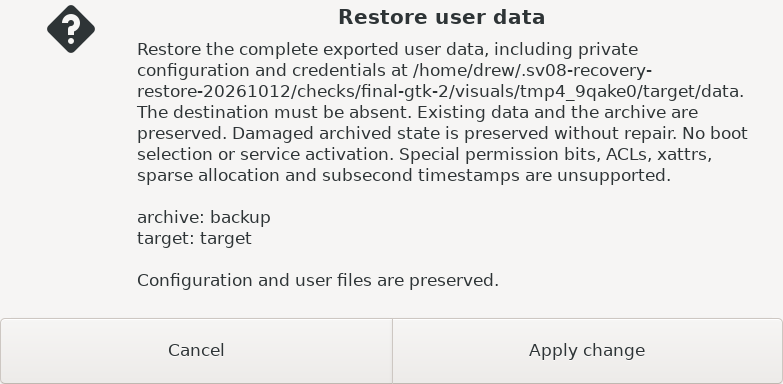

# Recovery restore delivery evidence

The recovery interface previously offered export but no complete user-data restore or explicit fresh-state action. It now lets an owner select a configured archive and prepared target, review the exact output root, cancel without mutation, restore the complete exported tree, or explicitly create fresh immutable state. Success and refusal messages distinguish preserved damaged archives from valid new defaults. Restoration never selects a boot slot or activates services.

The selected scope and five acceptance IDs remain in [the proposal](proposal.md). Candidate bytes and actual command logs/exit statuses are bound in [evidence.json](evidence.json); task submission binds these files to the final implementation commit. Baseline was 904fc0f7ceff0386f41c35ad4875685619eb572f; worktree base 0e55eb232ddb17015aaf2f252086b65864fec96e. No other work was replaced.

| Acceptance | Observed evidence |
| --- | --- |
| roundtrip | Complete current archive files/directories, private configuration, opaque database/WAL artifacts, modes, ownership and exact committed history fence; payload manifest/checksum validation and destination readback. Source archive and existing siblings preserved. |
| admission | Fixed reviewed policy/context, exact durable identities and complete inventory, distinct readonly recovery/archive and writable ext4 target, aliases/overlap/unsafe links/stale inputs/parent substitution/existing roots refused. Shared media lock contention tested. Existing export protections unchanged. |
| failure | Malformed/corrupt/truncated/duplicate/missing/extra file inputs, bounds, special links, space/inodes, silent output corruption and interrupted staging refuse publication. Postpublication guard/parent failure withdraws only the operation's own inode. Private partials remain identifiable; retry does not promote them. |
| fresh-state | Inspect/review/cancel are nonmutating. Explicit absent-root creation matches upstream defaults/layout/modes/ownership. Prepublication descriptor readback rejects corrupted bytes, wrong defaults, mode changes, nonempty lock, extra/missing entries. Existing or damaged destinations remain unchanged. |
| journey | Real GTK chooser, review, native focused-button activation, cancel, complete restore, refusal/refresh and fresh apply through actual controller/local filesystem. Author and coordinator inspected actual final reviews, completion and refusal images at 800×480; review width fits 800 pixels. |

Final corrected-source commands (private TMPDIR and PYTHONPATH=runtime:tests; existing installed tools):

```sh
python3 -m unittest -v test_restore test_recovery_restore_media test_stage_admin_ui test_recovery_image test_export test_admin test_host_state test_recovery_media test_admin_history test_admin_history_repairs
xvfb-run -a /usr/bin/python3 tests/recovery_restore_gtk.py
```

**148 tests pass**, exit 0, 14.614 process seconds including wrapper; final GTK exit 0 in 1.538 seconds. Source hashes remained unchanged during both runs. Earlier 147-test and GTK passes predate the fresh readback correction and are preserved separately. Staging/image closure checks pass; core integration copies runtime modules by glob. No new OS image was required. `git diff --check` passes.



Supplemental independent source assessment found a real fresh-state corrupt-success defect; its reproduction and historical failed assessment are retained in the JSON. The correction validates exact output bytes/defaults, full layout and metadata before publication. The same independent assessor inspected the correction and passed the bounded reassessment. This supplements source self-validation; it is neither a formal committed delivery verifier nor physical certification. No demonstrated wrong-target/existing-data-loss blocker remains under the shared media-writer model. Arbitrary privileged writers are outside that contract.

Failures were retained: initial descriptor ancestry/default-layout and synthetic history/provider fixture failures, wrapper startup failure before tests, safe TMPDIR correction for existing GTK fixture, and source-assessment corruption reproduction. No production guard was relaxed. The earlier bad fresh-review raster was overwritten before the retention request; previous hashes and actual inspection output exist, but no saved old raster is claimed.

Task-scoped named assignments: project_researcher with omitted effort; project_implementer with explicit medium effort and child-only repository sv08-ui-ux skill read; supplemental feature_verifier with its pinned medium profile. Fresh context was used; at most two children/one implementation. Effective model/effort telemetry was not independently observed here. No measured savings are claimed.

The primary allowance was 3600 process seconds/512 MiB generated data. Free local storage was checked (31 GiB); no tools were installed, OS images built or remote systems used. Known cumulative process usage conservatively stays below 120 seconds and generated fixture/evidence output below 32 MiB, including failed attempts; retained scratch was about 1.7 MiB before assembly. These are conservative accounting bounds, not measured token/cost savings.

## Limits and remaining qualification

Production restore requires independently prepared, identity-bound mounts, `/etc/sv08/recovery-restore-policy.json` and `/run/sv08-recovery/restore-context.json`. This delivery intentionally does not provision those inputs, guess target identities, mount/remount/format devices or activate restored data. Missing/stale trust inputs fail closed. Existing export admission is preserved; distinct restore preparation may make export unavailable rather than relax its guards.

Version 1 exports checksum file payloads and bind history, but cannot detect empty-directory additions/omissions or directory metadata changes made before review. The restore copies the directory entries in the current archive; it does not establish authenticity against an independently known original tree. ACLs, xattrs, sparse allocation and subsecond timestamps are unsupported; special permission bits are refused. Corrupt archived registry bytes are preserved, reported and never repaired. Fresh-state defaults must pass readback.

Physical target provisioning, real recovery-media/installed acceptance, normal-boot activation of the restored root and OS-slot restore remain separate existing project work. Kernel inventory/provider scenarios use controlled mocks; real local files/controller and GTK widgets were exercised. No printer access, live configuration changes, merge or deployment occurred. GTK's AT-SPI bus was unavailable under Xvfb; sampled native keyboard/render checks are not full accessibility or measured owner-usability qualification.
