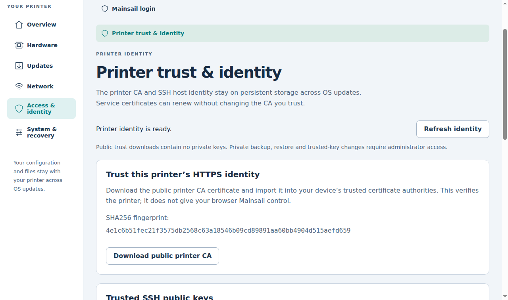

# Native ARM64 installed-stack recovery qualification

PR17's six original acceptance criteria pass on native ARM64/KVM. The implementation and final images are bound to `f14d190c8c0677bfe728f0993ae06d6d094cb19c`; subsequent publication changes contain evidence/coordination only. This supplements, and does not rewrite, [original evidence](evidence.md) and [review evidence](review-evidence.md). Detailed sanitized receipts, source hashes, image hashes, commands, attempts and accounting are in [native-evidence.json](native-evidence.json).

The original blocker is cleared: actual pinned Klipper f0892d82 reached ready in **4.061077 seconds**, using 3.926499 child CPU seconds, VmPeak 139352 KiB and RSS 38172 KiB. Observed limits remain CPU 8/8, AS 268435456 bytes, file 4194304 bytes and ten-second readiness. Actual QMP reports KVM enabled/present. The child remained running at ready and was reaped after TERM, exit-15; this is cleanup, not a validation failure. No TCG substitution, increased limits or invented explanation for the historical SIGKILL.

## Actual journey

| Acceptance | Observed result |
|---|---|
| Archive | Real normal-booted provisioned data exports, current scanner verifies it, actual installed recovery restores modes/ownership/literal links; archive and sibling hashes unchanged. Current final normal data also re-exports successfully (218 entries). V1 reading, malformed links, metadata/race/tamper and hardlink-fence refusal regressions pass. |
| Configuration | Saved factory configuration and published generation survive restore and regenerate the expected deterministic full bundle; actual pinned parser/debug validation succeeds under unchanged resource/readiness limits. |
| Services | Actual systemd normal boot runs Moonraker, Mainsail, Cockpit, SSH and NetworkManager. Real API/WebSocket, owner PAM login, finite helpers and sudo work; no fake service/API. |
| Persistence | Two distinct final-image restored boots preserve CA/SSH identity, selected hardware/configuration and exact private NetworkManager profile with actual activation. Strict CA/IP/hostname verification, pinned SSH host key, successful intended authentication and wrong/anonymous/other-generation refusal pass. |
| Rollback | Final recovery image executes reviewed rollback; a further final normal-image boot restores the previous hostname, CA/SSH identity, authentication and profile. Archive/sibling remain unchanged. |
| Regression | Focused root and native tests plus all four applicable GitHub jobs pass at implementation commit. Final publication CI is checked separately on the PR head. Complete stable source/test diff inspected; historical evidence preserved. |

Final normal SHA256: `c14d91b325551e2f4d52ee242fc7fbc2ed7ea796878b5639a5fc328b75a58c30`.
Final recovery SHA256: `f9c33cd047209d28f86ae5d151d6804b2b5ce9254a629543cb9f9172d2df0005`.
Both actual images were mounted read-only and their compressed filesystems and 12 critical installed runtime modules compared with current source. Fresh final recovery restore/activation, two final normal reboots, final recovery rollback and previous normal boot were then executed; earlier successful journeys remain supplementary evidence.

- restored-2: `2f6b8106-b877-4f8d-924f-b5f46a48d93e`
- restored-3: `5227f9cc-4fac-4ab1-993f-470899da1f82`
- previous: `53c4c379-7019-4f5d-a4dd-7104f19555cb`

## Repairs and validation

Narrow opaque identity selectors/systemd README links are metadata-bound in v2 archives; arbitrary links and unsafe objects still refuse, and v1 remains readable. Actual boot exposed generated journal 02755: preserve only anchored root-owned journal directories (numeric group, no borrowed group constant). Build fixes explicitly set chroot TMPDIR and normalize staged compressed payload 0644 without changing cached bytes or boot protections. Empty validated job history is committed through its existing locked writer; only typed pre-writer allocation contention defers initialization. CI's paused-upload status contract remains intact. Socket startup ordering and exact source-provenance recipe agree.

Observed checks: root history/link tests: 121 PASS (16.701s), root journal/link/export/restore/activation: 83 PASS (3.938s), root typed-busy/jobs/upload/history/export: 94 PASS (25.623s), worker focused: 37 PASS and upload/history: 45 PASS, builder: 29 PASS. Native tests covered 26 methods: 23 initially passed; 3 symlink-input fixtures correctly refused, then those 3 passed using the regular pinned dictionary and current read-only source (13.743s). Actual same-PID SAVE_CONFIG and old-reader fencing checks pass. These overlap; they are not summed into a unique-test count. Earlier local skips are retained in old logs and superseded where appropriate by root/native execution, not silently reported as passes.

Implementation CI: [deterministic](https://github.com/drew442/sv08-mainline/actions/runs/43678796142/job/132704696137), [deterministic-checks](https://github.com/drew442/sv08-mainline/actions/runs/43678796158/job/132704696396), [offline-regressions](https://github.com/drew442/sv08-mainline/actions/runs/43678796146/job/132704696055), [real-ownership](https://github.com/drew442/sv08-mainline/actions/runs/43678796147/job/132704696181): all SUCCESS. Final PR-head CI is reported in GitHub; these links prove the implementation revision specifically.

Commands used the tracked recovery_restore_stack.py restore/activate/rollback/normal-assert/host-assert/audit-boots phases, recovery_restore_stack_vm.py native backend, actual production validate_output via printer_validator_probe.py, and recovery_restore_stack_browser.mjs with installed Node/Chromium. Assigned host wrappers/private namespace paths and exact VM argv are retained in the JSON and private evidence. Host SSH forwarding was refused; browser used a restricted two-port localhost exec relay. Strict TLS checks precede narrowly scoped synthetic-leaf browser SPKI trust. No credentials, private keys, archive, raw image, browser profile or complete console transcript is published.

## Rendered assessment and execution

Coordinator inspected actual restored and previous screenshots: identity is fully ready, public CA action enabled, and displayed fingerprint matches the expected public CA DER digest. Actual Mainsail mounts and its native WebSocket connects; absent MCU status remains visible. An earlier loading capture is retained privately and was not accepted as ready-state evidence.

Named project_researcher/default-low and project_implementer/explicit-medium assignments used fresh task-scoped contexts. Coordinator ran provisioning, builds, VMs, browser, publication and records directly. No new verification team, model-quality or savings claim; effective runtime model/effort fields were not independently audited here. One implementation and two-child cap preserved.

## Bounds and retained failures

Cumulative ceiling: 25,200 process-seconds / 88 GiB. Prior charge: 12,200 seconds / 49.0625 GiB; new conservative charge: 10,750 seconds / 38.712213 GiB; cumulative: 22,950 seconds / 87.774713 GiB. The existing 6.9375 GiB unused prior output balance was explicitly allocated in the review plan; the owner's continuation adds 10,800 seconds / 32 GiB. Logical sparse container and its files are both charged; deleted and retired copies earn zero credit. Component ledger and process intervals are in JSON. No unrelated historic images were deleted.

- Special-device copy stopped; replaced with metadata-preserving cp-a.
- SFTP unavailable; authenticated SSH streams used.
- Probe A retained dependencies outdated; B staged current modules/catalog read-only and passed actual pinned validator.
- Assembly B exhausted parent inodes; retained receipt, private sparse ext4 workspace used.
- Assembly C inherited host TMPDIR into chroot; explicit /tmp fixed and regression checked.
- Missing sfdisk and NIC ROM supplied in private tool prefix; same normal build resumed with compressed bytes hash-preserved.
- Native regression fixture symlink dictionary correctly refused; only 3 affected methods rerun with real regular dictionary/source.
- SSH forwarding refused by policy; two-port localhost-only exec relay used.
- Bootstrap early prompt match corrected in same guest before provisioning; no acceptance attributed to bootstrap.
- Browser used obsolete action:status; corrected to actual method:status, real helper/auth tests retained.
- Recovery compressed payload 0600 correctly refused before PID1, target hash unchanged; producer now 0644 fresh/cache, 29 tests pass.
- Actual restore review refused generated journal 02755; narrow v2 anchored root journal-directory preservation added; 83 root checks passed.
- Normal empty job history lacked export manifest; initialize validated empty history through existing locked writer. CI then exposed allocation contention; typed pre-writer AllocationBusy alone defers commit; 94 root checks and unchanged paused-upload races pass.
- Identity screenshot initially captured loading state; final harness waits ready and verifies displayed CA fingerprint.
- Premature final normal launch overlapped recovery shutdown; QEMU target write lock refused before guest boot. Failed receipts retained; recovered by waiting for actual recovery exit before fresh normal launch. No concurrent writable guest ran.

Qualification remains **physical_hardware=false, printing_ready=false**. No MCU, motion/heater, physical SD, physical power-loss, factory fit or release qualification is claimed. Production Klipper gates/uncalibrated printing protections remain; Moonraker reports disconnected. PAM password portability is not claimed: the paired synthetic OS supplies PAM while restored native credentials, CA, SSH identity and authorized keys are exercised. No physical printer access, deployment or merge occurred. PR readiness concerns the six accepted software-recovery criteria only.
