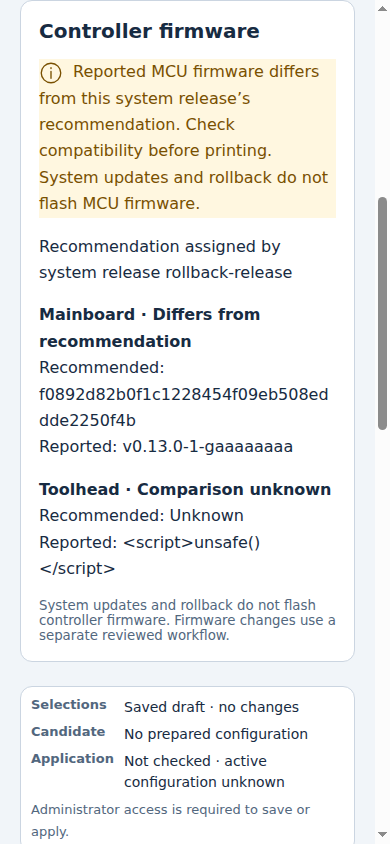

# Release delivery overhaul — source acceptance

Scope: the owner-approved delivery overhaul, including actual-test-printer/LAN
release scope and definition-based MCU firmware recommendations. This is source
and workflow delivery, not installation, commissioning or public binary release.
[Coverage](coverage.md) maps every accepted recommendation and distinguishes the
remaining product milestone. [Current handoff and goal prompt](../../../.codex/current-goals.md)
and [canonical release route](../../remaining-work-plan.md) are the current state.

## Operational changes

- Board definitions carry validated exact Klipper recommendations; immutable board
  versions/hashes and factory assembly references are updated, without changing
  hardware constants, selected user parts or calibration.
- Host integration embeds exact release definition snapshots. New generations get
  their release assignment; A→B→A retains the original assignment on rollback.
  Existing-generation tampering refuses; legacy missing information stays unknown.
- Ordinary hardware status compares the applied board mapping with fixed local
  Klipper read-only observations. Match/mismatch/unknown are distinct. Dirty,
  short, disconnected/unmapped observations do not become matching. Status, update
  and rollback never flash MCUs or start outputs. Existing bundle compatibility,
  calibration and admission protections are unchanged.
- Admin staging validates and records both new firmware/catalog dependencies.
  Missing/stale dependencies refuse before mutation. Observation connect/send/recv
  share the bounded deadline.
- Build CLI preflight checks tool presence, workspace byte/inode floors and mount
  prerequisites before expensive mutation. It does not install tools/remount hosts
  or establish factory-image fit.
- Superseded work has explicit provenance and remains distinct from done. Narrow
  subtree ownership checks adjacent paths, queue records and authorised proposal/
  requirements. The existing inventory understands the disposition. No scheduler,
  agent team, framework, model configuration or new publication authority is added.

## Verification

Observed passing checks (overlapping suites are not a unique-test total):

| Check | Result |
| --- | --- |
| Firmware definition/generation/rollback/status/read-only transport | 9 passed; actual temporary filesystem/Store, controlled socket transport |
| Existing host-state/config-view/definitions/configuration/bundle policy | 20/14/23/48/4 passed; unchanged applicable inputs reused after focused fixes |
| Admin staging dependency absence/drift/receipts | 24 passed |
| Host integration and recovery builder | 7 and29 passed |
| Project source/license and printer staging | 24 and13 passed |
| Feature workflow including v2/path contracts | 71 passed |
| Inventory and package/release CI runner | 19 and6 passed |
| Build preflight | 4 passed, including actual CLI refusal before stage dispatch |
| Agent policy, context and UI workflow | 18/9/24 passed; default models/roles unchanged |
| Release preparation | 12 passed; one existing exact-supplier-archive opt-in skipped locally, not a pass; hosted package/release gate supplies that exact pinned archive |
| Composed firmware browser | Match/mismatch/unknown, ordinary view/no elevation/no mutations,1024×600 and390×844, zero uncaught errors |
| Source/document checks | Changed Python/JS syntax, JSON, diff checks;62 active relative links and4 verbatim archive hashes checked before final prose additions |

New firmware checks are selected explicitly in existing Cockpit CI. Preflight
checks join existing package/release CI, and task-inventory compatibility remains
in the existing agent workflow. No new runner/dependency platform is installed.
Final PR-head CI is inspected separately; earlier green jobs do not prove a later
head. Exact local logs and hashes are retained in the coordinator's assigned
`/tmp/sv08-delivery-overhaul-20261117` and worker
`/tmp/sv08-delivery-mcu-20261117` evidence. Source-bound feature submission records
bind this document and affected files at the frozen candidate commit.

## Rendered assessment and limits

Worker and coordinator inspected the actual rendered states, including wrapped
revision text and literal untrusted strings. Browser transport is the existing
Cockpit session/RPC shim with synthetic firmware replies; this does not establish
installed Cockpit/PAM, physical MCU communication or performance. Backend tests
exercise assignment, applied-state mapping and finite transport separately.
Historical roots predating this code cannot retroactively display its warning:
supported rollback versions must include the policy, or have an explicit external
compatibility/maintenance plan. A recommended version match is not commissioning
or proof that an arbitrary firmware build is hardware-compatible.

## Retained failures and resource accounting

Initial new generation fixture used `/tmp`, correctly rejected by Budget ancestry;
assigned private home scratch fixed invocation without weakening protection.
Initial shared instruction additions exceeded existing context budgets; those
entries were restored/shortened and checks passed without raising limits. One
recovery test invocation lacked runtime PYTHONPATH; corrected invocation passed.
A mistyped workflow-v2 test pattern discovered zero tests and is not counted;
actual `test_feature_workflow*.py` discovery subsequently passed71. Initial workflow
supersession implementation used the wrong existing file_hash signature; repaired
and regression checked. A read-only supplier-archive lookup encountered protected
old fixture directories and supplied no usable input; no permissions/data changed,
and the local archive-dependent check remains explicitly skipped.

Source9a0f666 andeee598c, old leases7f29065453074b95a7d14c339e4d82ef /
1244fff48c714d9395a1a07514670f1f and all failed logs are retained. Two exact ownership
continuations addressed newly traced staging and inventory/CI consumers; no
attempt/allowance reset or fabricated historical hash refresh occurred.
Named project_implementer requested medium effort with fresh task scope; effective
model/effort was not independently audited. Coordinator owns records/Git and
ordinary test execution; self-validation is not independent verification.

Primary allowance7200 cumulative process-seconds/1GiB generated. Conservatively
charge2400seconds/768MiB including worker360seconds, fixture lifetime, three source
worktrees, tests, failed/removed scratch and publication reserve. No images,
physical printer access, flashing, host setup, deployment or merge. No monetary,
model-quality, token-saving or schedule-saving claim. Existing PR17/H12/H13 and
package/notice evidence is reused only at its recorded scope; the supported
candidate/clean-owner path and attended release qualification remain outstanding.

## PR38 CI repair continuation

Head0580be3 passed the agent/workflow and package/release CI jobs, but two other
jobs exposed test infrastructure issues. Preserve those failed logs rather than
relabel them as successful product acceptance:

- The firmware publication test used a workstation-specific parser source path.
  As root, the original fixture passes with that path available and reproduces
  unknown when it is absent. The product correctly refused to infer a match.
  The fixture now uses the existing checked-out pinned-source preference helper;
  root firmware9 pass and checkout-preference coverage passes.
- Two factory closure assertions still expected0.3.0 after the required immutable
  assembly bump to0.4.0. Corrected expectations retain component counts, retained
  unrelated components and calibration invalidation. Root factory10pass, one
  explicit existing native-parser opt-in skip; not claimed as native execution.
- The standalone automatic-policy browser failed before DevTools port readiness
  in CI and had no retained startup receipt/log. Its original form passes locally;
  the original CI Chrome cause is not established. Replace duplicate lifecycle
  handling with the existing tested browser_runtime helper, retaining the same
  ten-second readiness and all policy assertions. Bounded startup diagnostics are
  retained even after CI failure; profiles/state/credentials are not uploaded.
  The full repaired browser journey passes locally, with ready/exit0/cleanup
  complete. Existing launcher and PR9 checks each pass3tests. This does not claim
  that local success proves the runner environment; final CI is checked separately.

The attempted local automatic-policy fixture in the group-writable project path
correctly refused allocation ancestry. A new private local clone with restrictive
umask fixes the disposable invocation; no project permissions or production guard
were changed. Both fixture processes were stopped. Initial test-pattern and scope
renewal errors are retained in logs/history. No new images or installed tools.

All previous source/leases/attempts carry forward, including5f848f2 and0580be3.
Conservative cumulative charge is revised to3600process-seconds/896MiB within the
same7200seconds/1GiB primary allowance; it includes failed CI/fixture work, extra
private source checkout, browser profiles and publication reserve. No reset or
measured savings claim. The earlier2400seconds/768MiB was an interim estimate.
