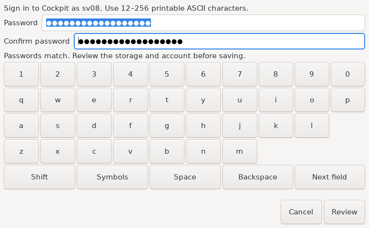
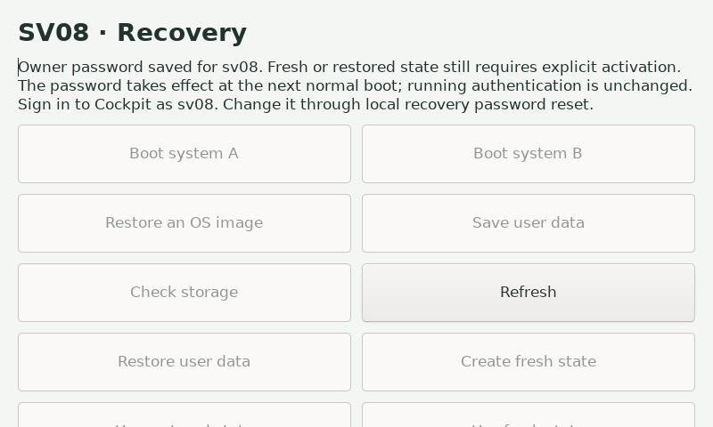

# Supported candidate — source checkpoint

The supported source path and clean-owner interaction are implemented. This is
a **source checkpoint**, not a supported release or installed/hardware acceptance.
The full native release goal remains active. Later continuation sections below
supersede earlier pending-state statements only for their named inputs. [Execution ledger](execution.json)
retains resources, attempts and target-preflight limitations; [intake](intake.json)
remains historical at its stated source.

Before: diagnostic-only integration required an owner SSH seed; no clean-owner
normal PAM enrollment, supported finalization/assembly or explicit Klipper-start
permission existed. After: an explicit measured profile stages production backend
documents and public trust; the existing independent recovery GUI enrolls/resets
private owner authentication; supported startup remains guarded. Normal calibration
and package-account behavior retain their existing boundaries.

149 selected root tests passed, no skips, in3.799seconds. The command selects owner,
recovery-owner, mounts, supported-candidate, commissioning, host-integration,
diagnostic-finalizer, recovery-image/media, environment-device, project-license,
boot, admin and baseline suites via unittest discovery with root-safe assigned
TMPDIR, runtime/scripts import paths and the exact pinned upstream source. AST,
JSON-schema, workflow structure, changed documentation links, gitlink/lock and
diff-whitespace checks pass. Native baseline reporting no longer requires a user
emulator on an actual ARM64 host; its actual build execution remains to run.

Actual disposable mount tests cover six A/B/mode boots, persistent owner reset,
immutable write refusal and writable package-style account append/atomic replace.
The 800x480 GTK test covers masked touch/keyboard entry, actual enabled Review
progression, both cancellation points, enrollment and no-write error feedback.
Coordinator inspected final screenshots and verified GTK source hash unchanged.
These are Linux namespace/Xvfb checks, not installed PAM or real HDMI/touch proof.

Failed attempts were retained privately: GTK overflow and focus selection; unsafe
root scratch ancestry; ambiguous transition capture; commissioning fixture helper
argument; two omitted dependency fixture entries; invocation import path; missing
private sbin PATH. Corrections preserve production refusal checks. Earlier97-test
run had two fixture errors; corrected final149-test run has none. Earlier owner
rootless skip is not promoted to a pass; final root execution supersedes it for
its applicable checks.

Fresh task-scoped named roles: project_researcher/default-low read-only tracing;
project_implementer/explicit-medium owner/GTK work with explicit relevant UX skill
read; fresh project_implementer/default-low provenance integration. Coordinator
owned integration, execution, records and publication. No independent review or
model/token savings is claimed; effective model/effort is not independently
observable in this task.

Remaining: hosted CI; actual clean-source normal/recovery/SD assembly and factory
capacity/headroom; native owner PAM/Cockpit and package integration; actual pinned
validator applicability; fitted-hardware confirmation; reviewed attended physical
installation/commissioning/printing/peripherals; candidate-specific signed LAN
update/fallback and independent recovery; qualified release/source/notice publication.
The SD target must be a different physical disk from its recovery root. Exact-CID
mode qualifies this named target only. Public-image portability to other printers
is not claimed. Ordinary owner password changes use local recovery; the static
owner-only PAM denial preserves system-user package operations. No physical
service/boot/configuration/output changes have been performed.

Final dependency inspection found recovery's base package lock lacked the OpenSSL
CLI used by the reused password helper. A default additive pinned supplement now
adds exactly openssl3.5.7-1~deb13u2, without changing the historical base lock or
upgrading its packages. Authenticated snapshot metadata and ordinary-user intake
verified the1,472,236-byte archive; its ARM copy has the same SHA256. New receipts
bind/recheck the supplement. Owner-enabled builds refuse a missing binary before
compression. A fresh default-low named implementer delivered this repair;45 affected
checks pass/no skips after the149-test source checkpoint (overlapping counts, not
a summed test total). Logs and hashes are in execution.json. Native CLI/PAM remains
a required check. Recovery component manifests retain the normal release/version/
source/MCU identity but remain deployable:false; normal manifests remain deployable:true.

## Native integration continuation

[Native receipts](native-evidence.json) bind actual ARM64/KVM checks to3f86bd2.
The factory and captured selected-hardware configurations reached ready under the
unchanged production8s CPU,256MiB address-space and10s readiness limits. Actual
query-kvm observed enabled/present, and both guests exited0. The repaired owner
probe passed29 checks using installed login/Cockpit PAM policies, enrollment/reset,
immutable/writable synthetic roots and a native service-account operation. This
does not establish normal boot, browser login, physical operation or release acceptance.
Owner confirmed the saved fitted components. No physical changes were performed.

Failed fixture permissions and a stale receipt-collection path were retained and
corrected; the second check executed only the affected owner probe. Normal
bootstrap/package/security refresh, pinned applications/Cockpit/RAUC and board
artifact checks pass. Final normal-root composition found a real hygiene/staging
mismatch: the canonical persistent Cockpit certificate link was rejected. The
source repair admits only that exact link without following it; populated private
directories, wrong links and embedded persistent data still refuse. Actual staging
regression coverage passes10 supported-candidate plus24 admin-staging tests. Its
first mkdir fixture error is retained. Current-source provenance/root finalization
must be rerun after publication of the repair; full board images remain unassembled.
All four hosted workflows passed at3f86bd2; newer-source CI must be checked separately.

## Boot lifecycle correction at dd65c33

Tracing the constructed66dce8d prototype found two product defects: persisted
commissioning permission had no reboot activation consumer, and successful trial
confirmation left the prepared boot record marked as a trial. The repair queues
Klipper only after real health and a full existing permission check; Klipper keeps
its own execution-time guards. Confirmation verifies the completed transaction and
publishes validated normal boot metadata before releasing readiness. 49 focused
source checks pass; related transaction/restart/boot checks add 62 passes and one
explicit opt-in namespace skip. Counts overlap earlier suites and are not summed.

The [native unit-contract receipt](boot-lifecycle-evidence.json) records two actual
ARM64/KVM boots, distinct kernel boot IDs, enabled/present query-kvm observations,
six cases per boot and both QEMU exits 0. Absent/revoked/stale permission and failed
health leave the stub stopped; valid permission queues it. Health and permission
are explicit stubs in this test. This does not prove production OS health, normal
board boot, physical MCU compatibility or printing. The first staging invocation
stopped before boot because host Python lacked a tarfile API; existing GNU tar
repaired only the disposable invocation. The failed attempt remains preserved.

All four hosted workflows pass at dd65c33: [package/release](https://github.com/drew442/sv08-mainline/actions/runs/44068120233),
[installed Cockpit](https://github.com/drew442/sv08-mainline/actions/runs/44068120228),
[deterministic Cockpit](https://github.com/drew442/sv08-mainline/actions/runs/44068120172)
and [agent workflow](https://github.com/drew442/sv08-mainline/actions/runs/44068120290).
Anonymous public source bytes match 635 project files. The superseded full prototype
was compressed and decompressed with its original 7,818,182,656-byte SHA256 verified
before raw disk/components were retired; hashes/receipts and one compressed archive
remain. Deleting files does not refund cumulative output. Repaired normal/recovery/
OTA outputs are being refreshed; prototype measurements are not relabelled as
current-source proof. No physical operation has occurred.

## Refreshed constructed candidate at dd65c33

[Candidate receipts](candidate-build-evidence.json) bind the repaired normal disk,
internal recovery and signed revision 5 OTA to the frozen production source. The
normal disk is 7,818,182,656 bytes and the bundle545,122,734 bytes. All six filesystem
checks and partition readbacks, SPL/both environment copies, trusted RAUC signer,
streamed payload hashes and embedded release identity pass. The default
selected-software preparation gate checked actual normal A/B/recovery roots,
anonymous public source, installed application payloads and selected notices.
Its generic hardware/legal/full-reproducibility limits remain explicit.

Data filesystem availability is 2,434,105,344 bytes/156,789 inodes. The modeled maximum
1 GiB bundle plus256 MiB state copy passes with 256 MiB assumed existing data and refuses
with 512 MiB; the measured545,122,734-byte bundle plus256 MiB copy also passes with 512 MiB
assumed existing data. These are admission calculations against measured filesystem
capacity, not measured printer data or actual allocation. Runtime refusal is retained.

The first trusted inspection wrote one 5,024-byte Python cache into its disposable
source root after raw payload construction. The invariant caught it; the cache and
failed log remain, and the exact pre-signing root inventory was restored. Repeating
only inspection with bytecode disabled passed without changing the bundle or any
production source. The record distinguishes the initial mutation from repaired
source preservation. Normal-parent/root receipts and owner/PAM metadata remain
unchanged. Historical prototype evidence and failed attempts were not rewritten.

Remaining release work: identify independent recovery/backup media, bind/build that
SD route, prepare the existing attended commissioning packet and obtain physical
operation authority/assessment. Then complete actual installation, normal boot/
browser access, MCU observation, commissioning/calibration/printing, required
peripherals and final candidate-specific LAN update/fallback/recovery acceptance.
Public binary release remains separately authorised and unperformed. The full
native goal remains active; this PR is a source checkpoint.

After all checks, eight redundant final partition/OTA raw components were retired
only after matching their hashes to the retained full disk and signed bundle.
Full current artifacts, recovery sources and every receipt remain; workspace free
space is 8,468,197,376 bytes. Cumulative output stays charged at 93 GiB, with no deletion
credit. Final artifact paths remain on the private ARM runner.

## Protected eMMC boot-area continuation at 7317a89

The new blank 16 GB SD was identified read-only on Beelink. Actual passive printer
inventory then exposed a missing production case: eMMC boot0/boot1 regions lack
independent card identity. [The bounded repair](boot-area-evidence.json) treats
them as protected, nonselectable children of their verified MMC owner, preserves
their live identities and write protections, and includes them in mount checks.
Writable/malformed/selected auxiliary areas refuse before probing or mutation.
Reviewed eMMC policies now include their extents; omitted topology refuses.

The named implementer reported 54 focused passes with exact source hashes. Of 99
related checks, 96 passed initially; two required a direct local build directory,
and one exposed a stale activation factory missing the required storage reserve.
The affected three pass after correcting disposable inputs and that fixture.
The rejected symlink attempt and original failures remain preserved. Production
storage checks were unchanged. Coordinator inspected the complete repair diff.

The reviewed candidate reader also succeeded in memory on the real printer: one
eMMC, six partitions and two readonly/force-readonly 4 MiB boot areas. This was
passive metadata/identity probing only, without installing files or changing
services, mounts, protection flags or storage. It does not prove recovery boot.
Anonymous public source at 7317a89 matches all 635 project files. Previous validator,
owner/PAM, rendered and unit-contract proofs retain their original stated scope;
this metadata fix does not turn them into physical acceptance.

The DD65 prototype is superseded/not for deployment. Its compressed archive was
decompressed and checked against the original full-image hash before retiring
the redundant raw disk. All receipts, source roots and earlier history remain.
Final SD composition still needs the separate USB backup disk; SD root, backup
and eMMC must remain distinct physical disks. Affected images will be refreshed
from cached pinned inputs once the complete medium policy can be bound, avoiding
another redundant artifact set. No printer or SD writes have occurred. The full
release goal remains active; this is a source correction checkpoint.

## Supplied USB and initial installation preparation, 2026-11-19

[Source-bound recovery media evidence](recovery-media-evidence.json) records the
actual USB identity extension, unchanged legacy identity shapes, fail-closed
whole-topology guards and two authenticated SD manifest bindings. The USB retains
its FAT32 filesystem; the existing read-only Beelink NFS source carries the full
installation image. No removable media has been mounted or written.

The offline installation-archive helper creates a new target-bound generation
while preserving original archive/generations, identity and calibration. It
quarantines inherited startup permission; unchanged activation/commissioning
checks require fresh permission. Root preservation/ownership checks pass. Its
production CLI also passed against the actual731 normal-A GPT filesystem on
native ARM with synthetic legacy data. This proves the image reader and offline
roundtrip, not an actual backup conversion or installation. The independent
assessment conditions in the JSON remain mandatory for actual data.

Production source is frozen at `c69618ea9ac060b8714d68c1751fd36bb653988c`
for one cache-reusing image refresh. Historical artifacts and failed attempts
remain recorded; source/record updates after this freeze do not relabel them.
Physical authority, current target/precondition checks, preserved original backup
and attended power-isolated media moves remain required before installation.
